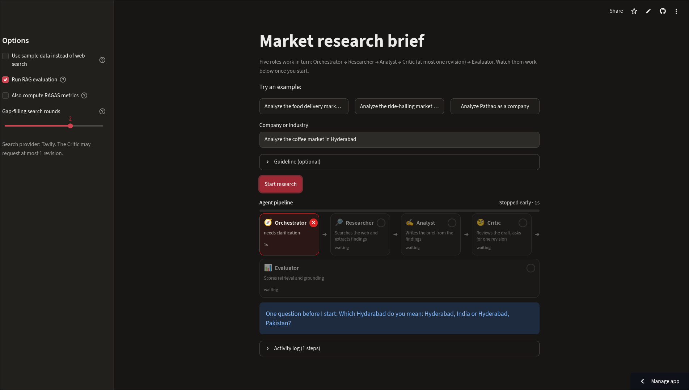
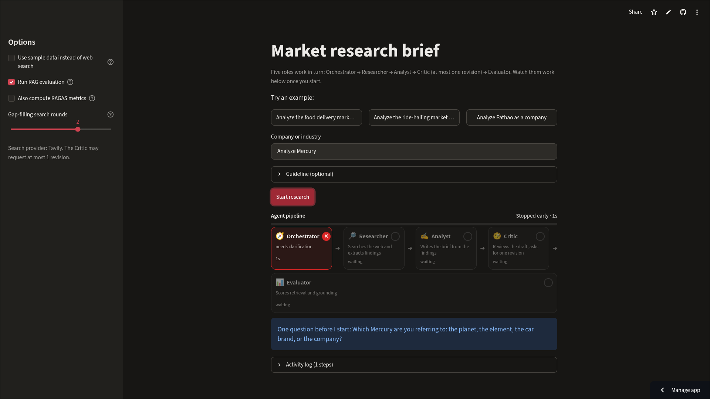
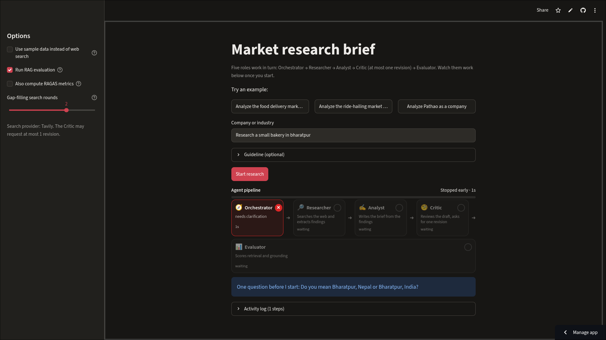
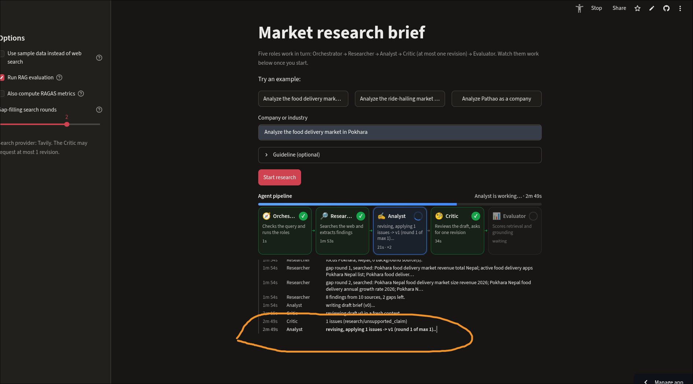
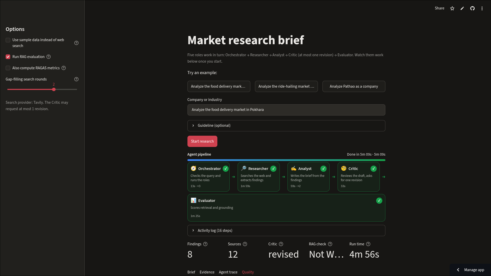
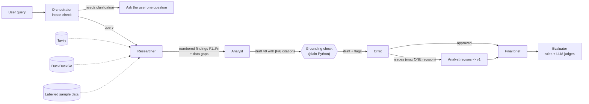

# Multi-Agent Market Research App

## Demo video
https://github.com/user-attachments/assets/b8599bad-5ac9-48b3-972e-bc29c1d51bb7

If the player does not load, open the recording directly: **[docs-screenshots/recording.mp4](docs-screenshots/recording.mp4)**

**Live demo:** https://researchagent-123.streamlit.app/ (click an example button; the first load after idle can take about 30 seconds).

---

## What this is, in one paragraph

A Streamlit app that turns a company or industry (for example *"Analyze the food delivery market in Nepal"*) into a
short, **cited** research brief. Five roles run in order (**Orchestrator, Researcher, Analyst, Critic, Evaluator**),
passing typed Pydantic objects to each other through a LangGraph state machine. The brief may only use numbered
findings (`F1`, `F2`, ...) that came from live web search (or from clearly labelled sample data). A plain-Python
grounding check flags every claim that has no evidence. The Critic may request **at most one revision**, and that
limit is enforced in code. Finally, an evaluator scores both retrieval and generation and gives a verdict:
`RAG WORKING`, `RAG NOT WORKING` or `RAG NOT ACTIVE`.

**Stack:** Python 3.10+, Streamlit, LangGraph, LangChain + Groq (`openai/gpt-oss-120b`), Tavily / DuckDuckGo search,
Pydantic v2, ReportLab (PDF export), FastMCP, pytest, ruff, Docker, GitHub Actions.

---

## Table of contents

1. [Setup on a new machine (Linux)](#1-setup-on-a-new-machine-linux)
2. [Setup on a new machine (Windows)](#2-setup-on-a-new-machine-windows)
3. [Other ways to run it (Docker, Dev Container, CLI, sample mode)](#3-other-ways-to-run-it)
4. [Using the app](#4-using-the-app)
5. [How it works](#5-how-it-works)
6. [Problems we hit and how we solved them](#6-problems-we-hit-and-how-we-solved-them)
7. [Evaluation: is the RAG actually working?](#7-evaluation-is-the-rag-actually-working)
8. [Tests, lint and CI](#8-tests-lint-and-ci)
9. [Claude Code: MCP server and skill](#9-claude-code-mcp-server-and-skill)
10. [Configuration reference](#10-configuration-reference)
11. [Troubleshooting](#11-troubleshooting)
12. [Known limitations](#12-known-limitations)
13. [Project structure](#13-project-structure)
14. [Credits](#14-credits)

---

## 1. Setup on a new machine (Linux)

Allow about 5 minutes. You need **Python 3.10 or newer**, **git** and one free **Groq API key**.

### 1.1 Install the prerequisites

```bash
# Debian / Ubuntu
sudo apt update && sudo apt install -y git python3 python3-venv python3-pip

# Fedora
sudo dnf install -y git python3 python3-pip

# Arch / Manjaro
sudo pacman -S --needed git python python-pip

python3 --version   # must print 3.10 or newer
```

### 1.2 Get the code and create a virtual environment

```bash
git clone https://github.com/cive202/Research_Agent.git
cd Research_Agent
python3 -m venv .venv
source .venv/bin/activate          # your prompt now starts with (.venv)
pip install --upgrade pip
pip install -r requirements.txt
```

> If you use [uv](https://docs.astral.sh/uv/): `uv venv && source .venv/bin/activate && uv pip install -r requirements.txt`.

### 1.3 Add your API keys

```bash
cp .env.example .env
nano .env                          # or any editor
```

Set at least:

```ini
GROQ_API_KEY=gsk_...               # required: https://console.groq.com/keys (free tier)
GROQ_API_KEY_1=gsk_...             # optional spare keys (_2, _3, ...): used in turn when one hits its rate limit
TAVILY_API_KEY=tvly-...            # optional: https://app.tavily.com (better search; without it DuckDuckGo is used)
```

### 1.4 Run it

```bash
streamlit run app.py
```

Open http://localhost:8501 and click **Analyze the food delivery market in Nepal**.

### 1.5 Check that everything is installed correctly (optional, no keys needed)

```bash
pytest -q        # 84 passed, 5 skipped (88 / 1 with reportlab installed): LLM and search are mocked
ruff check .
```

The `Makefile` has shortcuts: `make install`, `make run`, `make test`, `make lint`, `make sample`, `make docker`.

---

## 2. Setup on a new machine (Windows)

Use **PowerShell** (not the old `cmd.exe`).

### 2.1 Install the prerequisites

```powershell
winget install -e --id Python.Python.3.12
winget install -e --id Git.Git
# close and reopen PowerShell so python and git are on PATH
py --version       # must print 3.10 or newer
```

Without `winget`, install Python from https://www.python.org/downloads/ (tick **"Add python.exe to PATH"** in the
installer) and Git from https://git-scm.com/download/win.

### 2.2 Get the code and create a virtual environment

```powershell
git clone https://github.com/cive202/Research_Agent.git
cd Research_Agent
py -m venv .venv
.venv\Scripts\Activate.ps1
```

If PowerShell says *"running scripts is disabled on this system"*, allow it for this window only and activate again:

```powershell
Set-ExecutionPolicy -Scope Process -ExecutionPolicy Bypass
.venv\Scripts\Activate.ps1
```

Then install the dependencies:

```powershell
python -m pip install --upgrade pip
pip install -r requirements.txt
```

### 2.3 Add your API keys

```powershell
Copy-Item .env.example .env
notepad .env
```

Set `GROQ_API_KEY` (required) and optionally `TAVILY_API_KEY`, as in step 1.3, then save.

### 2.4 Run it

```powershell
streamlit run app.py
```

Open http://localhost:8501. To run the tests: `pytest -q`.

> `make` is usually not available on Windows; run the underlying commands from the `Makefile` directly.
> For sample-data mode in PowerShell: `$env:USE_SAMPLE_DATA="1"; streamlit run app.py`.

---

## 3. Other ways to run it

### Docker (Linux, macOS or Windows with Docker Desktop)

```bash
cp .env.example .env     # add your keys first
docker compose up --build
# http://localhost:8501
```

The CI pipeline builds this image and smoke-tests it on every push.

### Dev Container / GitHub Codespaces

`.devcontainer/devcontainer.json` uses the Python 3.11 image, installs `requirements.txt` and starts Streamlit on
port 8501. Open the repo in VS Code with the Dev Containers extension (or in a Codespace), then add your keys to `.env`.

### Command line (no UI)

```bash
python -m market_research run "Analyze the food delivery market in Nepal" --out brief.md
python -m market_research run --guideline guidelines/nepal-food-delivery.md
# options: --sample  --no-eval  --force-revision (tests the revision path)  --gap-rounds 0-3  --no-save
```

### Sample-data mode (no web search)

Tick **Use sample data** in the sidebar, or set `USE_SAMPLE_DATA=1`. The Researcher then uses fixed, illustrative
findings about Nepal food delivery. These are labelled everywhere: every finding starts with `SAMPLE:`, the UI shows a
warning banner, the summary starts with `SAMPLE DATA`, and the Markdown/JSON downloads carry the same warning. The app
also falls back to sample data automatically if no search provider works, and says why. You still need the Groq key.

### Hosting it online (optional)

The live demo runs on Streamlit Community Cloud (main file `app.py`, keys in the app's **Secrets**). The `Dockerfile`
also works on Hugging Face Spaces (Docker Space, port 8501), Render, Fly.io or Railway. Never put keys in the repo:
anyone with the URL can spend your LLM quota.

---

## 4. Using the app

1. Type a company or industry, or click one of the example buttons.
2. Optionally open **Guideline** and paste a markdown brief (angle, audience, key questions, seed links).
3. Watch the **Agent pipeline**: one card per role with live status, timing and a run counter (`×2` means the role
   ran twice, for example the Analyst writing and then revising). The **Activity log** lists every step.
4. Read the result in four tabs:

| Tab | What it shows |
|---|---|
| **Brief** | Summary, up to two competitors, key observations (each ends in a citation such as `[F2 · statista.com]` that links to the source), sources, missing information. Download as **Markdown**, **PDF** (A4, with clickable citations) or **JSON**. |
| **Evidence** | The numbered findings `F1..Fn` with source links and snippets. The brief may only cite these. |
| **Agent trace** | Per-role status and time, the structured data handed between roles, the Critic's issues, whether a revision happened, and the grounding flags. |
| **Quality** | The RAG evaluation scorecard with a reason for each metric, plus token use and run time. |

Sidebar options: sample data, run RAG evaluation, also compute RAGAS metrics, and **Gap-filling search rounds** (0-3).

### Screenshots

All screenshots are from real runs of the app (dark theme, Tavily search, Groq).

#### 1. Ambiguous city: "Analyze the coffee market in Hyderabad"

Hyderabad exists in India and in Pakistan. The Orchestrator stops after 1 second, before any search is done, and asks
one question that names both options. The Researcher, Analyst, Critic and Evaluator cards stay on *waiting*, so no
tokens or search credits are spent on the wrong market.



#### 2. Ambiguous name: "Analyze Mercury"

"Mercury" could be the planet, the element, the car brand or a company. The intake check asks which one is meant
instead of guessing.



#### 3. Small local business: "Research a small bakery in bharatpur"

Bharatpur is a city in Nepal and in India. Even for a lowercase, very local query, the app asks
*"Do you mean Bharatpur, Nepal or Bharatpur, India?"*. Adding the country to the query skips the question.



#### 4. The Critic catches an unsupported claim and the Analyst revises once

Query: *"Analyze the food delivery market in Pokhara"*. The activity log shows the Researcher's two gap-filling rounds
(searching for market revenue and growth), then *"8 findings from 10 sources, 2 gaps left"*. The Analyst writes draft
v0, the Critic reviews it in a fresh context and reports **1 issue (research/unsupported_claim)**, and the Analyst
revises: *"applying 1 issues -> v1 (round 1 of max 1)"*. The Analyst card shows `×2` because it ran twice. The
revision limit of one is enforced in code.



#### 5. The evaluator reports a failing RAG check instead of hiding it

The same Pokhara query, finished in about 5 minutes: 8 findings, 12 sources, Critic = *revised*, and **RAG check: Not
Working**. The pipeline itself completed normally (all cards green), but the evaluator judged that at least one
required check failed and says so on the main page. The **Quality** tab lists which metric failed and why. Quality
problems are shown, not hidden behind a finished-looking brief.



#### 6. A full exported brief

A full exported brief, with evidence, grounding check, Critic verdict and evaluation table, is in
[`docs-screenshots/research_brief.md`](docs-screenshots/research_brief.md).

---

## 5. How it works

### 5.1 Architecture



### 5.2 The roles

| Role | Files | What it does |
|---|---|---|
| **Orchestrator** | `workflow.py`, `intake.py` | Checks the input first: rejects gibberish or off-topic text, and asks **one** clarifying question when a name is ambiguous (Hyderabad, Bharatpur, Mercury). Then runs the roles as a LangGraph state machine, records a per-step trace and enforces the revision limit. |
| **Researcher** | `agents/researcher.py`, `retrieval.py`, `search.py`, `focus.py` | Plans 3 search queries **and the focus** (the place or company, e.g. `["Pokhara", "Nepal"]`), searches, filters irrelevant documents with an LLM, ranks on-focus sources first, extracts findings, removes repeated claims, numbers them `F1..F10` in code, then runs up to 2 **gap-filling rounds** that search for what is still missing. |
| **Analyst** | `agents/analyst.py` | Writes the brief from the findings only. Every observation and competitor must cite `[F#]`. The **sources list is rebuilt in code** from the cited findings, so the model cannot add a source it did not use. Style comes from `profiles/*.md` and one few-shot example. |
| **Critic** | `agents/critic.py` | Reviews the draft in a fresh LLM call, together with the grounding flags, and returns prioritised issues. If it approves a draft that still has grounding flags, **code overrules the approval**. |
| **Grounding check** | `grounding.py` | No LLM. Flags uncited observations, unknown `[F#]` IDs, more than two competitors, competitors without a finding, competitors backed only by background findings, and source URLs that were never retrieved. |
| **Evaluator** | `evaluation/` | Rule checks plus LLM judges on retrieval and on the brief, then a verdict (section 7). |

### 5.3 Data flow between agents

Every handoff is a Pydantic model in `market_research/models.py`:

```
Source        url, title, snippet, on_focus
Finding       id (F1.. set by code), claim, source_url, source_title, snippet, on_focus
Research      mode (web|sample), provider, focus[], queries[], sources[], findings[], data_gaps[]
Brief         summary, competitors[<=2], observations[], sources[], missing_information[]
Critique      approved, issues[{priority, category, text}], revision_instructions
WorkflowState query, guideline, research, drafts[v0, v1], critiques[], final, evaluation,
              metrics (seconds and tokens per step), trace[], revision_error, run_dir
```

Because IDs are given by code and not by the model, any citation can be checked mechanically.

### 5.4 One run, step by step

1. **Intake.** One small LLM call decides: research it, or ask one question. It *fails open*: if the LLM is down,
   the run continues.
2. **Plan.** The planner writes 3 queries and the focus. It is given today's date so it asks for recent data, not
   old years. Code appends the focus to any query that is missing it.
3. **Search.** Tavily → DuckDuckGo → labelled sample data. Results are de-duplicated by normalised URL (no scheme,
   `www.`, query string or trailing slash).
4. **Filter and rank.** An LLM keeps only relevant documents (it re-searches once if fewer than 60% or 4 survive).
   Code puts on-focus sources first and keeps at most 3 background sources, labelled as background.
5. **Extract.** The Researcher writes findings and data gaps, keeping the year or period of each figure and the
   source's own wording ("estimated", "forecast"). Code removes repeated claims, caps them at 10, numbers
   them and attaches a source snippet. URLs the model slightly mis-copied are snapped back to the retrieved URL.
6. **Fill gaps.** Up to `MAX_GAP_ROUNDS` (default 2) extra searches target the data gaps, then the Researcher
   re-extracts from at most 12 sources.
7. **Draft v0.** The Analyst writes the brief with `[F#]` citations. It keeps observed facts apart from estimates and
   forecasts, and lists guideline questions the findings cannot answer as "Could not be verified: ...". Code caps competitors at 2, rebuilds the
   sources list and adds honest-gap notes ("Evidence is thin", "No market size... figures were found").
8. **Review.** Grounding check, then the Critic (which also flags an estimate stated as fact, a dropped year, or an
   unanswered guideline question). Approved → done. Otherwise exactly one revision (v1). If the
   revision call fails, v0 is kept and the reason is shown, so the run is not lost.
9. **Evaluate and save.** The evaluator scores the run. Everything is saved to
   `runs/<time>-<query>/` (`research.md`, `draft_v0.md`, `draft_v1.md`, `reviews.md`, `final.md`, `final.pdf`,
   `state.json`), and one summary line is added to `runs/benchmarks.jsonl`.

### 5.5 Design principles

- **Evidence first:** the brief can only point at numbered findings; numbers are never invented.
- **Limits in code, not only in prompts:** 2 competitors, 1 revision, 10 findings, 12 sources.
- **Honest gaps:** missing information is listed, never guessed.
- **Web text is untrusted:** every prompt that contains retrieved text says to treat it as evidence only and to
  ignore instructions inside it (prompt-injection defence).
- **Fail soft:** timeouts, retries, friendly error messages, never a stack trace in the UI; partial results and the
  trace are kept.

---

## 6. Problems we hit and how we solved them

These are real problems found while running the app, with the fix and where it lives in the code.

### 6.1 Duplicate findings: the same fact cited several times

**Problem.** When several web pages said the same thing, the Researcher sometimes wrote the same claim once per
source. The brief then showed `F2`, `F5` and `F7` with identical text. This wasted the 10-finding cap on one fact and
made the brief look padded.

**Fix (two layers).**
1. *Prompt:* "List each fact once: if several documents say the same thing, write one finding and cite the most
   authoritative of them."
2. *Code, so it does not depend on the model:* `claim_key()` turns a claim into lowercase alphanumerics only, so
   differences in case, spacing and punctuation do not matter. `drop_repeated_claims()` keeps the first finding for
   each key. This runs **before** the cap and before numbering, so the cap counts distinct facts and the IDs have no
   gaps (`agents/researcher.py`). Search results were already de-duplicated by normalised URL (`urls.normalize_url`).
   Tested in `tests/test_focus.py`.

### 6.2 Groq "Request too large" (HTTP 413) on longer runs

**Problem.** Groq's free tier caps one request at 8,000 tokens, counting the **prompt plus `max_tokens`**. After gap
rounds, the Analyst and Critic prompts grew so much that Groq rejected requests even when the answer would have been
short.

**Fix.**
- `llm.output_budget()` estimates the prompt size and lowers `max_tokens` so the total fits under `GROQ_TPM_LIMIT`,
  but never below 1,200 output tokens.
- Prompts were made smaller: `findings_json()` and `draft_json()` send only what the model needs (no snippets, no
  retrieved-source list, since sources are rebuilt in code), and a revision skips the few-shot example.
- A 413 is explained in plain words with what to do (wait, lower gap rounds, or raise `GROQ_TPM_LIMIT`).

### 6.3 A failed revision lost the whole run

**Problem.** If the LLM call for the revision failed (rate limit, 413), the whole run errored out, even though a
reviewed draft already existed.

**Fix.** The revise step catches `LLMError`, keeps v0 as the final brief, records `revision_error`, and the trace and
Markdown export say *"changes requested, but the revision failed (...); this is the reviewed draft"* (`workflow.py`,
`rendering.py`).

### 6.4 Ambiguous places and names

**Problem.** "Coffee market in Hyderabad" mixed Indian and Pakistani sources. "Bharatpur" exists in Nepal and India.
"Analyze Mercury" could mean the planet, the element, the car brand or a company.

**Fix.** The Orchestrator's intake check asks **one** short question that names the options.
If a country or other detail is already in the query, it does not ask. The planner also always puts the country into
the search queries (`intake.py`, `retrieval.py`).

| "coffee market in Hyderabad" | "Analyze Mercury" | "small bakery in bharatpur" |
|---|---|---|
|  |  |  |

In every case the run stops at the Orchestrator in about 1 second, before any search or writing.

### 6.5 The brief drifted to other countries and global reports

**Problem.** A brief about Nepal cited global market-size reports and companies from India, because those pages rank
highly in search.

**Fix (`focus.py`, no LLM).** The planner names the focus. Code makes sure every query mentions it, ranks sources that
mention it first, and keeps at most 3 that do not, labelled **background**. The Analyst may use background only as
general context, and a competitor backed only by background findings is a grounding flag.

### 6.6 Searches for out-of-date years

**Problem.** The model often searched for "... 2022" or "2021-2023" because of its training data.

**Fix.** Planning prompts include today's date and say not to put a past year in a query.

### 6.7 The Critic approved claims that had no evidence

**Problem.** An LLM reviewer sometimes approved a draft that cited a non-existent finding or had an uncited sentence.

**Fix.** The grounding flags are facts computed in code, so if the Critic approves while flags remain, the approval is
**overruled in code** and the flags become issues for the revision (`agents/critic.py`). Critic issues are sorted by
priority, so the revision fixes the most important ones first.

In the run below, the Critic found one `research/unsupported_claim` in draft v0, and the Analyst revised once to v1:


### 6.8 Mangled or invented URLs

**Problem.** When copying long URLs, the model sometimes changed a character; at other times it made one up.

**Fix.** `urls.snap_urls()` repairs near-matches (≥ 0.9 similarity) to the URL that was actually retrieved, but
leaves invented URLs untouched so the grounding check and `citation_validity` metric catch them. The final source list
is built from the cited findings, not from what the model writes.

### 6.9 Invalid JSON from the model

**Problem.** Groq returns HTTP 400 `json_validate_failed` when the model's JSON does not match the schema.

**Fix.** `ask_json()` detects this and retries once with a note about the error. Each LLM call also has a 60-second
timeout and SDK retries (`llm.py`).

### 6.10 More than two competitors, uncited competitors

**Problem.** The assignment allows at most two competitors, but models like to list five.

**Fix.** The `Brief` model truncates to two and records how many were dropped. The grounding check flags any
competitor without a supporting finding.

### 6.11 Making failures visible instead of hidden

- Errors become one-line messages (missing key, wrong key, rate limit, request too large, no network); see
  `llm.explain_error()`.
- The **RAG check** tile shows `Pass` / `Fail` / `Not active`, and when it fails, the failing checks are listed under
  the metrics with a pointer to the Quality tab.
- Sample data can never pass as real data: it is labelled in the findings, UI, summary and downloads, and the
  evaluator returns `RAG NOT ACTIVE` for it.

### 6.12 UI problems

- The pipeline cards overflowed on narrow screens. They now use a CSS grid that drops to two columns on phones, with
  arrows that turn green as each role finishes.
- Citations were bare `[F3]`. They are now links labelled with the domain, e.g. `[F3 · statista.com]`, so a reader
  can see and open the source.

### 6.13 Keeping the project simple

An AWS Bedrock provider and Terraform/ECS deployment were tried and then **removed**: they added setup steps and cost
without improving the brief. Groq is the only LLM provider, and hosting uses free options.

---

## 7. Evaluation: is the RAG actually working?

A brief that *reads* well can still be wrong. The evaluation system answers three separate questions, each with its
own tool:

| Question | Tool | When it runs |
|---|---|---|
| Did **this run** retrieve good evidence and write a brief grounded in it? | Per-run scorecard (8 metrics + verdict) | After every run (sidebar **Run RAG evaluation**, CLI default) |
| Can the **evaluator itself** be trusted to catch bad briefs? | Tamper test (negative control) over a query set | `python -m market_research eval` |
| Is the brief **good enough for a client**, the way a human expert would judge it? | Calibrated pass/fail judge, measured with precision/recall/F1 against human labels | `label` → `calibrate` → `judge` |

Code: `market_research/evaluation/` (`rules.py`, `judges.py`, `verdict.py`, `tamper.py`, `batch.py`,
`calibration.py`, `ragas_eval.py`). The evaluator is the last node of the LangGraph workflow. It **only measures**
and never edits the brief: fixing the brief is the Critic's job, and keeping the two apart stops the system from
grading its own homework.

### 7.1 How the evaluator differs from the grounding check and the Critic

| Layer | Runs | Uses an LLM? | Purpose |
|---|---|---|---|
| Grounding check (`grounding.py`) | Before the Critic, and again on the final brief | No | Mechanical: does every `[F#]` exist, is every URL retrieved, ≤ 2 competitors? Feeds the Critic. |
| Critic (`agents/critic.py`) | Once per draft | Yes | Improves the brief: finds problems and asks for one revision. |
| Evaluator (`evaluation/`) | After the final brief | Rules + separate judge model at temperature 0 | Measures retrieval **and** generation and gives a verdict. Changes nothing. |

### 7.2 The per-run scorecard

The metrics cover both halves of RAG: **retrieval** (did we find the right documents?) and **generation** (did the
brief stay faithful to them?).

| # | Metric | Half | Type | How it is computed | Pass rule | In verdict? |
|---|---|---|---|---|---|---|
| 1 | `retrieval_check` | Retrieval | Rule | Counts sources, unique domains and empty snippets; fails if retrieval was not live | ≥ 3 sources, ≥ 2 domains, no empty snippets, live web | Yes |
| 2 | `retrieval_relevance` | Retrieval | LLM judge | Judge sees the query and numbered documents and returns the IDs that are relevant. Score = relevant / retrieved | ≥ 0.60 | Yes |
| 3 | `research_faithfulness` | Retrieval → findings | LLM judge | Every finding is a claim; the judge marks each supported/unsupported against the retrieved snippets | ≥ 0.70 | Yes |
| 4 | `brief_groundedness` | Generation | LLM judge | Summary, each competitor note and each observation are claims, checked against the findings + snippets | ≥ 0.70 | Yes |
| 5 | `citation_validity` | Generation | Rule | Every URL in the brief's sources must be one that was retrieved (normalised URL match). Also reports coverage, e.g. "5/12 retrieved sources used" | 100% | Yes |
| 6 | `structure_check` | Generation | Rule | Summary present, ≤ 2 competitors, ≥ 3 observations, sources present, missing-information present | All present | Yes |
| 7 | `style_check` | Generation | Rule | Banned "AI-slop" phrases (`delve`, `tapestry`, `game-changer`, ...), em dashes, vague generalisations (`most companies`, `many users`) | No hits | No (informational) |
| 8 | `gap_honesty` | Generation | LLM judge | Compares findings, data gaps and the brief's missing-information list: does the brief admit what it does not know and avoid claiming it? | honest = true | No (informational) |
| + | `ragas_faithfulness`, `ragas_context_precision` | Both | RAGAS library | Optional cross-check with an industry-standard library (sidebar **Also compute RAGAS metrics**) | ≥ 0.5 | No (informational, never blocks) |

Every metric returns a score from 0 to 1, pass/fail, a one-line **reason** and **details**. For the judges, the
details name each unsupported claim, so a failing score can be checked by hand instead of trusted blindly.

**Why claim-level judging?** Asking an LLM "is this brief faithful? 1-10" gives vague, unstable numbers. Here the
judge gets a numbered list of claims and returns supported/unsupported **for each one**. The score is then a plain
ratio computed in code (`6/8 claims supported`), which is easier to audit and more stable from run to run.

### 7.3 The verdict

```
sample data used?          -> RAG NOT ACTIVE   (retrieval was not exercised, so it cannot "work")
all 6 required metrics pass -> RAG WORKING
otherwise                  -> RAG NOT WORKING  + the list of failed checks
```

In the UI, the **RAG check** tile shows `Pass`, `Fail` or `Not active`. On a fail, the failed checks are printed under
the metrics, and the **Quality** tab shows the full table with reasons. The same table goes into the Markdown export
and `state.json`.

Example of a run that completed but **failed** the RAG check. The tile says *Not Working* instead of hiding the
failure behind a finished-looking brief:


### 7.4 Making the judges trustworthy

- **Different model.** Judges use `GROQ_JUDGE_MODEL` (`.env.example` sets `openai/gpt-oss-20b`); the agents use
  `GROQ_MODEL` (`openai/gpt-oss-120b`). A model grading its own writing tends to be lenient.
- **Temperature 0** for repeatable scores.
- **Strict instructions:** "set supported=true only if the evidence *explicitly* supports it".
- **Prompt-injection guard:** retrieved web text is marked as evidence only; instructions inside it are ignored.
- **Fail-soft:** a RAGAS error becomes a "skipped" metric and never changes the verdict or breaks the run.
- **Thresholds in one place:** `MIN_SOURCES`, `MIN_DOMAINS`, `MIN_RELEVANCE`, `MIN_FAITHFULNESS`,
  `MIN_GROUNDEDNESS` in `market_research/config.py`.

### 7.5 A real example

From a live Pokhara run ([`docs-screenshots/research_brief.md`](docs-screenshots/research_brief.md)):

| Metric | Score | Pass | Reason |
|---|---|---|---|
| retrieval_check | 1.00 | yes | 12 sources, 12 domains |
| retrieval_relevance | 1.00 | yes | 12/12 retrieved documents judged relevant (need 60%) |
| research_faithfulness | 0.75 | yes | 6/8 claims supported (need 70%) |
| brief_groundedness | 1.00 | yes | 8/8 claims supported (need 70%) |
| citation_validity | 1.00 | yes | all cited URLs were retrieved; 5/12 retrieved sources used |
| structure_check | 1.00 | yes | all sections present |
| style_check | 1.00 | yes | no slop phrases or vague generalisations |
| gap_honesty | 1.00 | yes | missing-information list matches the data gaps |

**Verdict: RAG WORKING.** The evaluator still named the two findings it could not verify from the snippets (a
restaurant count for Foodmandu and a claim about payment options). That is exactly the kind of detail a reviewer needs.
A run where checks fail shows **Fail** in the RAG tile (screenshot in section 4), with the failing checks listed.

### 7.6 Does the evaluator itself work? The tamper test

An evaluator that always says "pass" is useless, so it is tested with a **negative control**:

```bash
python -m market_research eval                  # queries from test_queries.json, writes eval_results.json
python -m market_research eval --sample         # same, with labelled sample data (no search)
```

`test_queries.json` holds 5 queries (Nepal food delivery, Daraz in Nepal e-commerce, India EV market, Nepal digital
wallets, global coffee chains). For each one the batch runs the full workflow, then builds a **tampered copy** of the
final brief (`evaluation/tamper.py`) with:

- one invented observation: *"The market grew 340% in 2024 after a government ban on all competitors."*
- one fake source: `https://made-up-research.example/report-2024`

and scores the copy again. The evaluator is **OK** only if:

```
tampered citation_validity FAILS   and   tampered groundedness < real groundedness
```

Output table: `query | verdict | rel | grnd | cite | t.grnd | t.cite | evaluator OK?`. Every row should say `yes`.
The same check runs offline in the test suite (`test_web_run_is_rag_working_and_tamper_is_caught`).

### 7.7 Calibrating an expert judge against human labels

The scorecard checks **grounding**. Whether a brief is actually **useful** (follows the angle, answers the key
questions, is not vague) needs human judgement. So there is a pass/fail judge that is aligned with *your* labels and
measured like a binary classifier (`evaluation/calibration.py`).

**What makes the judge say FAIL:** a fact or figure the findings do not support; ignoring the guideline's angle or a
key question the findings could answer; hiding an important gap; more than two competitors; vague text or generic AI
filler. It writes the critique first, stopping at the first real problem, then the label.

**Workflow:**

```bash
# 1. Label real runs yourself (never let an LLM write the outputs or the labels).
python -m market_research label runs/<run> --label fail \
    --critique "States a 2023 market size the findings do not contain."
#    optional: --version 0 to label a specific draft, --split train|dev|test to override the split

# 2. Measure the judge on the dev split
python -m market_research calibrate --split dev

# 3. Read the disagreements, adjust JUDGE_SYSTEM or add train labels, repeat.
# 4. Check once on the held-out test split
python -m market_research calibrate --split test

# 5. Use it on a new run
python -m market_research judge runs/<run>       # prints PASS/FAIL and the critique
```

**Design choices:**

| Choice | Why |
|---|---|
| Labels in `eval_data/dataset.jsonl`, one row per run (and version) | Plain text, easy to diff and review |
| **Deterministic split** 40/30/30 train/dev/test from a SHA-1 hash of the row ID | Re-labelling never moves a row between splits, so test data does not leak into the few-shot examples |
| Train rows become few-shot examples, **balanced** pass/fail, at most 4 | The judge does not learn a default answer |
| **"fail" is the positive class**, reported as precision, recall, F1, accuracy and a confusion matrix | The judge exists to catch bad briefs, so recall on fails matters most |
| Calibrating on `train` is refused | Scoring the examples the judge was shown would be meaningless |
| Every disagreement is printed with both critiques; results saved to `eval_data/calibration-<split>.json` | You see *why* the judge disagrees, not just a number |
| dev much higher than test → overfitting warning | The prompt was tuned to dev |

Aim for at least 20-30 labelled runs before trusting the score: with five rows per split, a perfect F1 means little.

### 7.8 Observability

Every run saves `runs/<time>-<query>/state.json` with the full shared state, the evaluation report, and per-step
seconds and LLM tokens, along with `research.md`, `draft_v0.md`, `draft_v1.md`, `reviews.md` and `final.md`
(plus `final.pdf`, an A4 PDF of the same brief, when `reportlab` is installed). These run folders are what you
label in 7.7.

Across runs, `runs/benchmarks.jsonl` gets one JSON line per run, failed runs included: query, status and error,
total seconds, model, data mode, findings, versions, Critic approval, verdict, grounding flags, total LLM calls and
tokens, and the per-step metrics in the order the steps ran. Read it with
`market_research.benchmarks.load_benchmarks()`, or e.g. `jq -s 'map({query, status, total_seconds})' runs/benchmarks.jsonl`.

With `pip install opik` and `OPIK_API_KEY` (or `OPIK_URL_OVERRIDE`), every
workflow step, LLM call and MCP tool call is also traced as a span with inputs, outputs and latency.

### 7.9 What the evaluation does not prove

- The judges are LLMs too. Claim-level scoring, a separate model and the tamper test reduce this risk; they do not
  remove it.
- Faithfulness is checked against **snippets**, not full pages, so a true claim from an unread part of a page can be
  marked unsupported (the Pokhara example above is likely one).
- There is no gold "correct brief" for open market questions, which is why the expert judge is calibrated on human
  labels instead.

---

## 8. Tests, lint and CI

```bash
pytest -q          # 84 passed, 5 skipped (88 / 1 with reportlab installed); no API keys needed
ruff check .
```

| Test file | Covers |
|---|---|
| `test_grounding.py`, `test_workflow_mock.py` | Grounding flags, competitor cap, sources derived from citations, honest thin-evidence notes, Critic approval overruled by flags, one-revision limit (a Critic that always rejects still gets exactly one revision), labelled sample-data fallback, handoff order, friendly errors, JSON-retry, Tavily → DuckDuckGo order, URL de-duplication, intake clarification, citation links |
| `test_focus.py` | Focus helpers and ranking, background cap and labels, date/recency in planning, prompt-injection guard in every prompt, failed revision keeps v0, 413 message and shrinking answer budget, slim prompts, **repeated claims merged before the cap** |
| `test_metrics.py` | URL normalisation and snapping, retrieval / citation / structure rules |
| `test_improvements.py` | Tamper test is caught, sample mode = `RAG NOT ACTIVE`, forced revision, relevance filter, RAGAS optional and non-blocking |
| `test_workshop_features.py` | Gap rounds, prioritised Critic issues, style check, run artifacts, guidelines, profiles, MCP tools, judge calibration |
| `test_reference_features.py` | Evidence rules in the Researcher / Analyst / Critic prompts, `runs/benchmarks.jsonl` (success, failed run, broken line, unwritable folder), PDF export (A4 pages, "Page X of Y" on every page, tables, numbered lists, unicode punctuation, empty brief; skipped without `reportlab`) |
| `test_progress.py` | Live pipeline progress rendering |
| `test_app_smoke.py` | Headless run of the real Streamlit app |

GitHub Actions (`.github/workflows/ci.yml`) runs ruff, pytest and a Docker build + smoke test on every push.

---

## 9. Claude Code: MCP server and skill

The same tools are also served over MCP (`market_research/mcp_server.py`, FastMCP), so an agent such as Claude Code
can run the research itself. There the agent decides the next question from the gaps each search returns, and the
server does the work.

| Kind | Name | What it does |
|---|---|---|
| tool | `research_question(working_dir, question)` | One search round: search, filter, extract; saves `memory/NNN-search.json` |
| tool | `read_links(working_dir, urls?)` | Reads the guideline's seed links (or given URLs) into memory |
| tool | `compile_research(working_dir, remaining_gaps?)` | Merges memory into `research.md` / `research.json` |
| tool | `write_brief(working_dir, iterations, evaluate)` | Draft + review loop + evaluation; writes `output/` |
| prompt | `research_workflow(working_dir)` | The recipe: when to call which tool, and where to stop for the user |
| resource | `config://settings`, `profiles://{name}`, `guideline://template` | Read-only settings, profiles and template |

`.mcp.json` registers the server; start Claude Code from the project root with the virtualenv activated (or set
`"command"` to the full path of `.venv/bin/python`). The project skill `.claude/skills/market-research/SKILL.md`
wraps the workflow: ask *"research the food delivery market in Nepal"* or run `/market-research`. Claude creates
`research/<slug>/guideline.md`, stops for you to confirm it, researches, stops again at `research.md`, and writes the
brief.

---

## 10. Configuration reference

Environment variables (`.env`):

| Variable | Default | Meaning |
|---|---|---|
| `GROQ_API_KEY` | (required) | LLM for all roles |
| `GROQ_API_KEY_1`, `_2`, ... | empty | Extra Groq keys (e.g. for hosting); on a 429 / 401 / 403 the next key is tried and stays active for later calls |
| `TAVILY_API_KEY` | empty | Better web search; DuckDuckGo is used without it |
| `GROQ_MODEL` | `openai/gpt-oss-120b` | Model for the agents |
| `GROQ_JUDGE_MODEL` | same as `GROQ_MODEL` | Model for the evaluator (use a different one if you can) |
| `GROQ_TPM_LIMIT` | `8000` | Per-request token cap used to size `max_tokens`; `0` disables it |
| `USE_SAMPLE_DATA` | `0` | `1` = labelled sample data instead of web search |
| `INTAKE_CHECK` | `1` | `0` = skip the Orchestrator's clarification check |
| `OPIK_API_KEY`, `OPIK_WORKSPACE`, `OPIK_URL_OVERRIDE`, `OPIK_PROJECT_NAME` | empty | Optional tracing |

Limits in `market_research/config.py`: `MAX_FINDINGS=10`, `MAX_SOURCES=8`, `MAX_TOTAL_SOURCES=12`,
`MAX_GAP_ROUNDS=2`, `MAX_BACKGROUND_SOURCES=3`, `MAX_REVIEW_ITERATIONS=1`, `LLM_TIMEOUT=60s`, evaluation thresholds.

**Guidelines and profiles.** Instead of a one-line query you can pass a markdown guideline (`guidelines/TEMPLATE.md`,
example `guidelines/nepal-food-delivery.md`) with angle, audience, key questions, must-include items, seed links and
constraints. Key questions become the first searches, and the Analyst and Critic both see the guideline. Writing style
comes from `profiles/character.md`, `structure.md`, `terminology.md` and one example in `profiles/examples/`.

---

## 11. Troubleshooting

| Symptom | Likely cause | Fix |
|---|---|---|
| "GROQ_API_KEY is not set" | `.env` missing or still has the placeholder | `cp .env.example .env`, add your key, restart Streamlit |
| "The LLM rejected the API key" | Wrong or expired key | Create a new key at console.groq.com |
| "The LLM rate limit was hit" | Groq free-tier limit (on every key) | Wait a minute, add `GROQ_API_KEY_1`, `_2`, ..., lower gap rounds, or untick **Run RAG evaluation** |
| "The request was too large..." | Prompt + answer above `GROQ_TPM_LIMIT` | Lower gap rounds, retry in a minute, or raise `GROQ_TPM_LIMIT` if your plan allows |
| "PDF export needs `pip install reportlab`" | `reportlab` is not installed in your environment | `pip install -r requirements.txt` (or `pip install reportlab`), restart Streamlit |
| "Could not reach the LLM service" | No internet, VPN or firewall | Check the connection and retry |
| Yellow "Sample data mode" banner | Checkbox, `USE_SAMPLE_DATA=1`, or no search provider worked | Untick it; check internet and keys |
| "Evidence is thin" / few results | Search returned little (DuckDuckGo is weaker) | Add `TAVILY_API_KEY`, or name the company and country |
| "One question before I start: ..." | The name is ambiguous | Add the country or the type of business to the query |
| `ModuleNotFoundError` | Virtualenv not active | Activate `.venv`, then `pip install -r requirements.txt` |
| PowerShell blocks `Activate.ps1` | Execution policy | `Set-ExecutionPolicy -Scope Process -ExecutionPolicy Bypass` |
| `python3 -m venv` fails on Ubuntu | `python3-venv` not installed | `sudo apt install python3-venv` |

---

## 12. Known limitations

- Search quality limits brief quality. With little evidence the brief says so instead of guessing.
- The grounding check proves a citation points at a real finding, not that the finding supports the sentence. The
  Critic and the LLM judges cover that, and they are model judgements themselves.
- One revision only, by design. The revised brief is not reviewed again; earlier versions are kept in the trace.
- Search snippets are read, not full pages, so details outside the snippet are missed.
- Duplicate removal catches identical claims (ignoring case and punctuation), not paraphrases of the same fact; the
  prompt asks the model to merge those.
- Groq's free tier is rate limited, and DuckDuckGo may throttle automated queries.
- The PDF uses the built-in PDF fonts, so characters outside basic Western European text (for example Devanagari)
  print as `?`. The Markdown and JSON downloads are unaffected.
- Results depend on what search returns at that moment, so reruns can differ.
- This is retrieval-augmented generation over live web search; there is no vector database.

---

## 13. Project structure

```
app.py                         Streamlit UI: examples, live pipeline, tabs, downloads
market_research/
  workflow.py                  Orchestrator: LangGraph graph, trace, revision limit, failed-revision fallback
  intake.py                    Clarify or decline vague / ambiguous / off-topic queries
  agents/
    researcher.py              Plan, search, filter, extract, de-duplicate, number, gap rounds
    analyst.py                 Draft and revise the brief from findings only
    critic.py                  Independent review; approval overruled when grounding flags remain
    sample_data.py             Labelled illustrative findings
  retrieval.py                 Query + focus planning, relevance filtering
  search.py                    Tavily -> DuckDuckGo, URL de-duplication
  focus.py                     Focus in every query, on-focus ranking, background cap (no LLM)
  grounding.py                 Grounding flags and source derivation (no LLM)
  urls.py                      URL normalisation and snapping
  llm.py                       Groq wrapper: token budget, JSON retry, friendly errors
  models.py                    Pydantic models shared by all roles
  rendering.py                 Markdown / JSON export with linked citations
  pdf.py                       A4 PDF export (ReportLab), built from the same Markdown
  benchmarks.py                Cross-run log: one line per run in runs/benchmarks.jsonl
  progress.py                  Live agent-pipeline cards
  evaluation/                  rules, judges, verdict, tamper test, batch eval, calibration, RAGAS
  config.py                    Env lookups, limits, thresholds
  guideline.py profiles.py artifacts.py tracing.py tools.py mcp_server.py cli.py
guidelines/  profiles/         Editable markdown inputs
samples/  sample_output.md     Real and sample-data outputs produced by the app
docs-screenshots/              Demo video, screenshots, exported brief
tests/                         pytest, mocked, no keys
.claude/skills/  .mcp.json     Claude Code skill and MCP registration
.github/workflows/ci.yml       ruff, pytest, Docker build + smoke test
Dockerfile docker-compose.yml Makefile .devcontainer/
```

---

