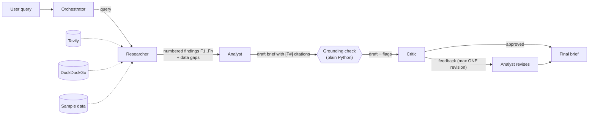

# Multi-Agent Market Research App

A Streamlit app that turns a company or industry (for example *"Analyze the food delivery market in Nepal"*) into a
short, **cited** research brief. Four roles run in sequence (Orchestrator, Researcher, Analyst, Critic), pass
structured Pydantic data to each other, and the brief may only use numbered findings (`F1`, `F2`, ...) that came from
web search or from clearly labelled sample data. A plain-Python grounding check flags any claim without evidence, and
the Critic may request **at most one revision**.

**Live demo:** https://researchagent-123.streamlit.app/ (click an example button; the first load after idle can take about 30 seconds).

## Quick start (about 5 minutes)

```bash
git clone <your-repo-url> && cd <repo-folder>
python -m venv .venv && source .venv/bin/activate     # Windows PowerShell: see below
pip install -r requirements.txt
cp .env.example .env                                   # then put your GROQ_API_KEY in .env
streamlit run app.py
```

Open http://localhost:8501 and click **Analyze the food delivery market in Nepal**. That is all.

You need one key: a free [Groq API key](https://console.groq.com/keys) for the LLM. Web search needs no key
(DuckDuckGo); a free [Tavily key](https://app.tavily.com) gives better results.

<details>
<summary><b>Windows (PowerShell) setup</b></summary>

```powershell
git clone <your-repo-url>; cd <repo-folder>
py -m venv .venv
.venv\Scripts\Activate.ps1          # if blocked: Set-ExecutionPolicy -Scope Process Bypass
pip install -r requirements.txt
Copy-Item .env.example .env          # then edit .env in Notepad and add GROQ_API_KEY
streamlit run app.py
```
</details>

<details>
<summary><b>macOS / Linux setup</b></summary>

```bash
git clone <your-repo-url> && cd <repo-folder>
python3 -m venv .venv && source .venv/bin/activate
pip install -r requirements.txt
cp .env.example .env && ${EDITOR:-nano} .env
streamlit run app.py
```
</details>

Python 3.10 or newer is required.

### Getting API keys

| Key | Needed? | Where | Notes |
|---|---|---|---|
| `GROQ_API_KEY` | **Yes** (LLM for all four roles) | https://console.groq.com/keys | Free tier, rate limited |
| `TAVILY_API_KEY` | No | https://app.tavily.com | Better search; without it the app uses DuckDuckGo |

Never commit `.env` (it is in `.gitignore`); `.env.example` only holds placeholders.

## What you see

After a run the page has four tabs:

- **Brief**: summary, up to two competitors, key observations (each ends with citations like `[F2]`), sources, and
  missing information. Buttons download it as **Markdown** or **JSON**.
- **Evidence**: the table of numbered findings `F1..Fn` with source links and snippets. The brief can only cite these.
- **Agent trace**: per-role status and timing, the structured data handed from role to role, the Critic's verdict,
  whether a revision happened, and the grounding flags.
- **Quality**: evidence count, the RAG evaluation scorecard and run cost.

Progress per role is shown live while the agents work. Example buttons above the input fill in a query and start it.

### Sample-data mode

Tick **Use sample data** in the sidebar (or set `USE_SAMPLE_DATA=1`) to skip web search. The Researcher then uses fixed,
illustrative findings about Nepal food delivery. This is labelled everywhere: every finding starts with `SAMPLE:`, a
warning banner is shown in the UI, the brief summary starts with `SAMPLE DATA`, and the Markdown and JSON downloads
carry the same warning. The app also falls back to sample data automatically when no search provider works, and says
why under "missing information". The LLM key is still required, because the Analyst and Critic still call the model.

### Optional: Docker

```bash
docker compose up --build            # http://localhost:8501, reads keys from your local .env
```

### Optional: put it online (not required)

The assignment only needs a local run. If you want a public link, the options below all work with this repo as it is
(set `GROQ_API_KEY` and optionally `TAVILY_API_KEY` in the host's secrets page, never in the repo). I have not
deployed to any of them.

| Host | Cost | Fit |
|---|---|---|
| [Streamlit Community Cloud](https://streamlit.io/cloud) | Free | Easiest: connect the GitHub repo, main file `app.py`, add secrets in Settings. Public apps need a public repo. |
| [Hugging Face Spaces](https://huggingface.co/spaces) | Free tier | Create a Docker Space and push this repo; it uses the `Dockerfile` (set the port to 8501 in the Space README header). |
| [Render](https://render.com) | Free tier (sleeps when idle) | New Web Service from the repo, Docker runtime; env vars in the dashboard. |
| [Fly.io](https://fly.io) or [Railway](https://railway.com) | Small paid or trial credit | Deploy the `Dockerfile`; keeps running without idle sleep. |

Anyone with the URL can spend your LLM quota, so share it carefully.

## Architecture



| Role | File | What it does |
|---|---|---|
| Orchestrator | `market_research/workflow.py`, `intake.py` | Checks the query (asks a clarifying question for vague, off-topic or ambiguous input, such as a city name that exists in two countries), runs the roles in order with a LangGraph state machine, records the trace, enforces the revision limit |
| Researcher | `market_research/agents/researcher.py`, `search.py`, `focus.py` | Plans 3 queries and the focus (place or company), searches (Tavily, else DuckDuckGo, else sample data), dedupes by URL, extracts at most 10 findings and numbers them F1.. in code |
| Analyst | `market_research/agents/analyst.py` | Writes the brief using only the numbered findings; every observation and competitor cites `[F#]`; sources are derived from the cited findings |
| Critic | `market_research/agents/critic.py` | Reviews the draft in a fresh LLM call, together with the grounding flags |
| Grounding check | `market_research/grounding.py` | No LLM. Flags uncited observations, unknown `[F#]` IDs, more than two competitors, competitors without a finding, competitors backed only by background findings, source URLs not in the findings |

All roles use the same Groq model. Every handoff is a Pydantic model (`market_research/models.py`): `Research` (findings),
`Brief` (draft), `Critique` (feedback), all held in one `WorkflowState` together with the run trace.

## Design decisions

- **Evidence first.** IDs are assigned by code, not by the model, so a citation can be checked mechanically. The model never
  sees or writes the ID field.
- **Limits live in code, not only in prompts.** The Brief model truncates competitors to two (and records how many were
  cut); the workflow graph refuses a second revision whatever the Critic says (`MAX_REVIEW_ITERATIONS = 1`).
- **The Critic cannot wave through ungrounded claims.** If the grounding check has flags and the Critic approves anyway,
  the approval is overruled and the flags become issues for the revision.
- **Honest gaps.** If evidence is thin or contains no figures, code adds "Evidence is thin..." and "No market size,
  revenue or market share figures were found" to the brief. Numbers are never invented.
- **Fail soft.** LLM calls have a timeout and retry once on invalid JSON. Errors are turned into short messages (missing
  key, rate limit, no network); the UI never shows a stack trace. The trace and any partial result are kept.
- **Stay on the market that was asked about.** The planner names the focus (for example `Bharatpur, Nepal`). Code then
  adds it to every search query, ranks sources that mention it first and keeps at most 3 that do not, labelled
  background. The Analyst may use background only as general context, and a competitor backed only by background is a
  grounding flag. Planning prompts get today's date, so searches ask for recent data instead of old years.
- **Web text is untrusted.** Every prompt that shows retrieved text tells the model to treat it as evidence only and
  ignore instructions inside it.
- **Search fallback chain.** Tavily, then DuckDuckGo, then labelled sample data, so the app always produces something
  that is honest about its source.

## Tests and lint

```bash
pytest -q          # no API keys needed: LLM and search are mocked
ruff check .
```

The tests cover the grounding checker, the competitor cap, the one-revision limit (a Critic that rejects every time still
gets one revision), sample-data labelling, handoff order, the search provider order, friendly error messages, and a
headless run of the real Streamlit app. GitHub Actions runs ruff and pytest on every push (`.github/workflows/ci.yml`).

## Sample outputs

`sample_output.md` and `samples/` hold real outputs produced by the app itself (see `samples/README.md`):

- `samples/real_run_nepal_food_delivery.md` / `.json`: live Tavily search, one Critic revision, no grounding flags.
- `samples/sample_data_run_nepal_food_delivery.md` / `.json`: sample-data mode, labelled as such.

## Troubleshooting

| Symptom | Likely cause | Fix |
|---|---|---|
| Red box "GROQ_API_KEY is not set" | `.env` missing or still has the placeholder | `cp .env.example .env`, paste your key, restart Streamlit |
| "The LLM rejected the API key" | Wrong or expired key | Create a new key at console.groq.com and update `.env` |
| "The LLM rate limit was hit" | Groq free tier limit | Wait a minute, or set a smaller `GROQ_MODEL`, or untick **Run RAG evaluation** to save calls |
| "Could not reach the LLM service" | No internet, VPN or firewall | Check your connection, retry |
| Yellow banner "Sample data mode" | Checkbox ticked, `USE_SAMPLE_DATA=1`, or no search provider worked | Untick the box; for live results check your internet and keys |
| Few or irrelevant results, "Evidence is thin" | Search returned little (DuckDuckGo is weaker than Tavily) | Add a `TAVILY_API_KEY`, or make the query more specific (company, country) |
| `ModuleNotFoundError` | Dependencies not installed in the active environment | Activate the venv, then `pip install -r requirements.txt` |
| PowerShell blocks `Activate.ps1` | Execution policy | `Set-ExecutionPolicy -Scope Process Bypass`, then activate again |

## Known limitations

- Search quality decides brief quality. With little evidence the brief says so instead of guessing.
- The grounding check proves that a citation points at a real finding, not that the finding supports the sentence. The
  Critic and the evaluation scores cover that, and they are themselves model judgements.
- One revision only, by design. The revised brief is not reviewed again; earlier versions are kept in the trace.
- Snippets, not full pages, are read (no scraping), so details that are not in the snippet are missed.
- Groq's free tier is rate limited, and DuckDuckGo may throttle automated queries.
- The brief reflects what the web search returned at that moment; rerunning can give a different result.

## Advanced: guidelines, profiles, review budget

Instead of a one-line query you can pass a markdown guideline (`guidelines/TEMPLATE.md`, example
`guidelines/nepal-food-delivery.md`) with the angle, audience, key questions, must-include items, seed links and
constraints. Key questions become the first searches and the Analyst and Critic both see the guideline. Writing style
comes from `profiles/*.md` and one few-shot example in `profiles/examples/`. After extraction the Researcher also reads
its own data gaps, plans follow-up searches for them and re-extracts. The number of rounds is the sidebar slider
"Gap-filling search rounds" (0-3, default `MAX_GAP_ROUNDS` = 2) or `--gap-rounds` on the CLI; 0 turns it off and
saves about a third of the tokens.

Every run writes `runs/<time>-<query>/` with `research.md`, `draft_v0.md` (and `draft_v1.md` if revised), `reviews.md`,
`final.md` and `state.json` (full shared state, per-step seconds and LLM tokens). `--no-save` on the CLI skips this.

### Command line

```bash
python -m market_research run "Analyze the food delivery market in Nepal" --out brief.md
python -m market_research run --guideline guidelines/nepal-food-delivery.md
# options: --sample  --no-eval  --force-revision (tests the revision path)  --gap-rounds 0-3
```

## Claude Code: MCP server and skill

The same tools are served over MCP (`market_research/mcp_server.py`, FastMCP), so an agent harness such as
Claude Code can drive the research itself. Here the agent is the brain: it reads the gaps each search returns and
decides the next question. The server is the hands.

| Kind | Name | What it does |
|---|---|---|
| tool | `research_question(working_dir, question)` | One search round: search, filter, extract findings; saves `memory/NNN-search.json` |
| tool | `read_links(working_dir, urls?)` | Reads the guideline's seed links (or given URLs) into memory |
| tool | `compile_research(working_dir, remaining_gaps?)` | Merges memory into `research.md` / `research.json` |
| tool | `write_brief(working_dir, iterations, evaluate)` | Draft + review loop + evaluation; writes `output/` |
| prompt | `research_workflow(working_dir)` | The recipe: when to call which tool, and where to stop for you |
| resource | `config://settings`, `profiles://{name}`, `guideline://template` | Read-only settings, profiles and template |

All handoffs are files in the working folder (`guideline.md`, `memory/`, `research.md`, `output/`), so you can read
or edit any step before the next one.

Setup: `pip install fastmcp` (already in `requirements.txt`), then start Claude Code from the project root with the
virtualenv activated. `.mcp.json` registers the server (`/mcp` should list `market-research`; if Claude Code does
not use your venv, change `"command"` to the full path of `venv/bin/python`). The project skill
`.claude/skills/market-research/SKILL.md` wraps the workflow: ask "research the food delivery market in Nepal" or
`/market-research`, and Claude creates `research/<slug>/guideline.md`, stops for you to confirm it, researches,
stops again at `research.md`, and writes the brief. Skills load only their name and description until used, which
keeps the context small; the MCP server is what makes the logic easy to share with other clients.

## Evaluating the RAG ("is it working?")

After each run the evaluator scores both halves of the pipeline:

| Metric | Type | Question |
|---|---|---|
| `retrieval_check` | rule | Were >=3 sources from >=2 domains retrieved live, with non-empty snippets? |
| `retrieval_relevance` | LLM judge | What share of the retrieved documents is relevant to the query? (>= 0.6) |
| `research_faithfulness` | LLM judge | Are the Researcher's findings supported by the retrieved snippets? (>= 0.7) |
| `brief_groundedness` | LLM judge | Are the brief's claims supported by the findings and snippets? (>= 0.7) |
| `citation_validity` | rule | Was every URL cited in the brief actually retrieved? (must be 100%) |
| `structure_check` | rule | Summary, <=2 competitors, >=3 observations, sources, missing info present? |
| `style_check` | rule | No AI-slop phrases, em dashes or vague generalisations like "most companies"? (informational) |
| `gap_honesty` | LLM judge | Does the brief admit what the evidence does not cover? (informational) |

**Verdict:** `RAG WORKING` when all required checks pass, `RAG NOT WORKING` (with the failing checks listed)
otherwise, and `RAG NOT ACTIVE` when sample data was used, because retrieval was not exercised.
Thresholds live in `market_research/config.py`. Judge calls use temperature 0 and
`GROQ_JUDGE_MODEL`; set it to a different model than `GROQ_MODEL` so the model is not grading itself.

**Does the evaluator itself work?** Run the batch evaluation:

```bash
python -m market_research eval   # runs test_queries.json, writes eval_results.json
```

For every query it also scores a *tampered* copy of the brief (one invented claim and one fake URL) and
checks that groundedness drops and citation validity fails. The last column, "evaluator OK?", should be `yes`.

Note: this is retrieval-augmented generation over live web search results; there is no vector database.

### Calibrating an expert judge (pass/fail + critique)

The metrics above check grounding. Whether a brief is actually *good* needs your judgement, so the project
includes an LLM judge you align with your own labels, treated like a binary classifier:

```bash
# 1. Label real outputs of the system (never let an LLM write the outputs or labels).
#    pass/fail plus 2-3 sentences; for a fail, stop at the first real problem.
python -m market_research label runs/<run> --label fail --critique "States a 2023 market size the findings do not contain."
#    Rows go to eval_data/dataset.jsonl and get a fixed train/dev/test split (40/30/30 by id hash, or --split).

# 2. Measure the judge on dev. Train rows are its few-shot examples (balanced pass/fail, MAX_JUDGE_EXAMPLES=4).
python -m market_research calibrate --split dev   # prints F1/precision/recall on "fail" and every disagreement

# 3. Adjust JUDGE_SYSTEM in evaluation/calibration.py or add train rows, repeat; then check once on test.
python -m market_research calibrate --split test  # dev much higher than test = the judge overfits

# 4. Use it on new runs.
python -m market_research judge runs/<run>
```

Aim for at least 20-30 labelled runs (more is better) before trusting the score; with five per split a perfect F1
means little. Results are saved to `eval_data/calibration-<split>.json`.

### Tracing (optional)

`pip install opik` and set `OPIK_API_KEY` (Comet cloud, plus `OPIK_WORKSPACE`) or `OPIK_URL_OVERRIDE`
(self-hosted). Each workflow step, LLM call and MCP tool call then becomes a span in the `market-research`
project (`OPIK_PROJECT_NAME`), with inputs, outputs and latency. Without it nothing changes; the per-step time and
token counts are in `state.json` either way.

## Project structure

```
app.py                       Streamlit UI (tabs, example buttons, live role progress, downloads)
market_research/
  config.py                  Env lookups, limits, evaluation thresholds
  models.py                  Pydantic models for shared data (Finding, Research, Brief, Critique, WorkflowState)
  grounding.py               No-LLM grounding check and source derivation
  focus.py                   No-LLM focus enforcement: focus in every query, on-focus ranking, background cap
  workflow.py                Orchestrator (LangGraph), agent trace, revision limit
  search.py                  Tavily, then DuckDuckGo
  llm.py                     Groq wrapper: timeout, JSON validation, retries, friendly errors
  intake.py                  Orchestrator check: clarify or decline queries that are not a company or industry
  rendering.py               Markdown / JSON export
  agents/                    researcher.py, analyst.py, critic.py, sample_data.py
  evaluation/                rules.py, judges.py, verdict.py, tamper.py, batch.py, calibration.py
  guideline.py profiles.py urls.py artifacts.py tracing.py tools.py mcp_server.py cli.py
guidelines/  profiles/       Editable markdown inputs
samples/  sample_output.md   Real and sample-data outputs
tests/                       pytest (mocked, no API keys)
.github/workflows/ci.yml     ruff, pytest, Docker build + smoke test
Dockerfile docker-compose.yml Makefile   Container and shortcuts
```

## Credits

Structure and ideas were informed by open-source market-research agent projects (MIT licensed), including
Market-Intelligence-Agent and Market-Research-Agent. The focus/background ranking and the ambiguity question were
inspired by ai-research-assistant by Royas Shakya (MIT). No code was copied from them.
